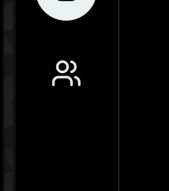
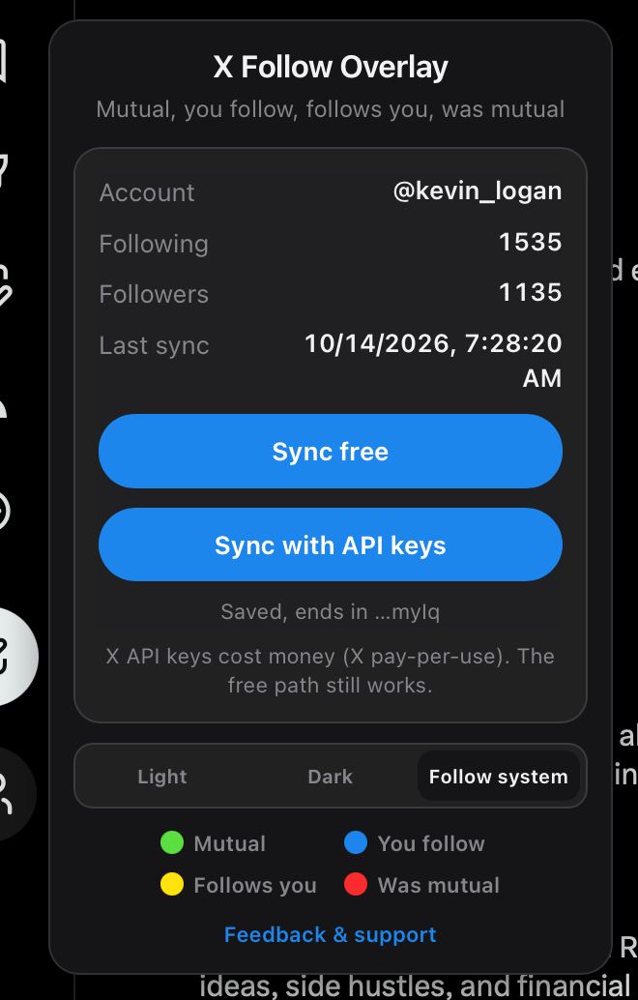
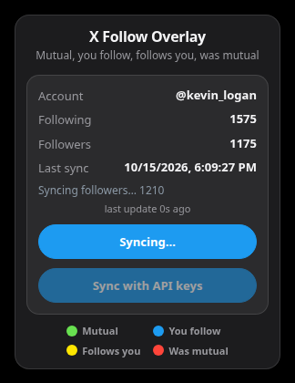
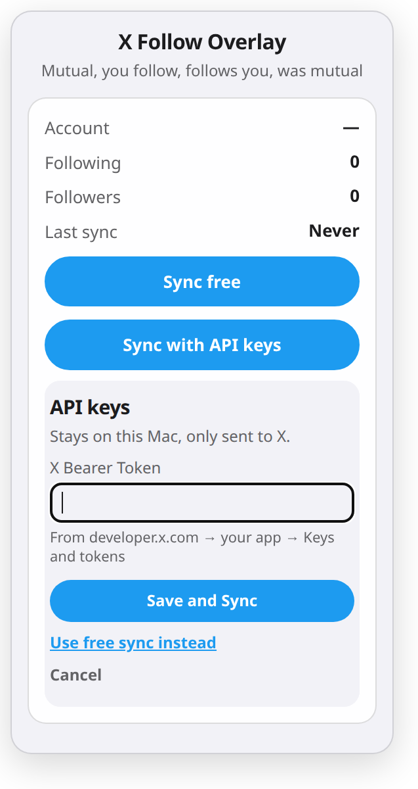

# X Follow Overlay

Free dots on profile pictures at x.com.

- **Green** — you follow each other
- **Blue** — you follow them
- **Yellow** — they follow you
- **Red** — they used to be a mutual

No account with us, no payment, and no API key required. Sync uses the x.com tab you are already signed into.

## Download

[Download the latest Mac release](https://github.com/KevinLogan84/XFollowOverlay/releases/latest)

The Mac download is the Safari app. Chrome and Edge load the extension folder instead (below).

## Install on Safari (Mac)

1. Download the latest release and open it. If macOS asks, move **X Follow Overlay** to Applications.
2. Open **X Follow Overlay** once.
3. Safari → Settings → Extensions.
4. Turn on **X Follow Overlay**.
5. Allow **x.com** when Safari asks.
6. Open x.com and sign in.
7. Click the people icon under **Post**, then **Sync now**.

## Install on Chrome or Edge

1. Download the project (or clone it) so you have the folder that contains `manifest.json`.
2. Open `chrome://extensions` (Edge: `edge://extensions`).
3. Turn on **Developer mode**.
4. Click **Load unpacked**.
5. Choose that folder.
6. Open x.com, sign in, and click **Sync now** on the people icon under **Post**.

You can also open the extension’s toolbar button. It walks through the same three steps: sign in, sync, and optional API keys.

## First sync

1. **Sign in on x.com** in this browser.
2. **Run Sync.** The extension reads follows from that signed-in tab. It does not need a key.
3. Add **API keys** only if you want a faster sync. This step is optional.

Only one sync runs at a time, so long follower syncs no longer freeze Safari or force-close the x.com tab. Big accounts sync slower. x.com limits how fast any signed-in tab can read follow lists. Leave the tab open. When X asks the extension to slow down, it waits and then continues.

## Optional: your own API keys

Keys are optional. They can sync a large account faster than the free tab.

1. Create an app at [developer.x.com](https://developer.x.com).
2. Copy your API key, API key secret, access token, and access token secret. A bearer token works too if that is what the portal shows.
3. Open the X Follow Overlay toolbar button.
4. Paste the key and choose **Save and Sync**.

The key stays on this Mac and is only sent to X. It is not in the download.

## Your API keys stay private on your Mac and are sent only to X (api.x.com)

Free sync works without a key. It is slower because X limits how fast a signed-in tab can read follow lists. API keys are optional, and X charges for them.

A key you paste is stored only in the extension’s local storage on this Mac:

- Bearer token: `xApiBearer`
- API key, API key secret, access token, and access token secret, if you paste those too: `xApiKey`, `xApiSecret`, `xAccessToken`, `xAccessSecret`

Nothing in that list is written into this repository, into logs, or into telemetry. The extension sends those values only to `api.x.com` (`https://api.x.com/2/…`), in the Authorization header. Any other host is refused.

## Troubleshooting

- **Sync asks you to sign in.** Open x.com in this browser, sign in, and run Sync again. A saved sync from another account is not used.
- **Sync sits on “Waiting for X rate limit”.** Leave the x.com tab open. That wait is X’s own limit. Large accounts hit it sooner.
- **“last update 12s ago” counts seconds since sync last made progress.** A rate limit shows “Waiting for x.com rate limit, resuming in 4:10” and, if you have no API keys, “Want faster syncs? Add your own X API keys (paid, optional). The free sync keeps working.” A silent page is retried once after 2 minutes, or after 20 seconds when that request times out, and shows “Sync stalled on this page…” after one more wait of the same length. Your place in the list is saved.
- **No dots.** In Safari, confirm the extension is on and x.com is allowed. In Chrome, confirm the extension is enabled and you loaded the folder that contains `manifest.json`. Then reload x.com.
- **Safari does not list the extension.** Safari → Settings → Extensions. For a copy you built yourself, Safari’s Develop menu has **Allow Unsigned Extensions**.

## Uninstall

**Safari:** Safari → Settings → Extensions → X Follow Overlay → Uninstall. Then delete **X Follow Overlay** from Applications.

**Chrome or Edge:** open the extensions page, find X Follow Overlay, and choose Remove.

## Feedback & support

Questions or trouble: [kevinlogan@mail.grokbot.com](mailto:kevinlogan@mail.grokbot.com)
